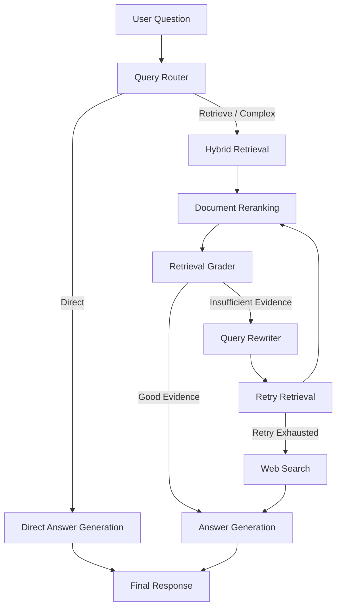

# CodeRAG — Agentic RAG for Software Engineering QA

An Agentic Retrieval-Augmented Generation (RAG) system designed to answer software engineering questions using repository documentation, semantic search, and external web search.

CodeRAG combines adaptive query routing, hybrid retrieval, document reranking, retrieval evaluation, query rewriting, and LLM-based answer generation to provide context-aware responses.

## Overview

Traditional RAG systems generally follow a fixed retrieval-and-generation pipeline. CodeRAG introduces an agentic workflow in which the system evaluates incoming questions, determines the appropriate execution path, assesses retrieved evidence, and performs additional retrieval when necessary.

The system supports three query routes:

- **Direct:** Answers general questions using the language model without repository retrieval.
- **Retrieve:** Searches the indexed repository and generates an answer using retrieved evidence.
- **Complex:** Uses a more extensive retrieval process for questions requiring additional context.

When retrieved evidence is insufficient, the system can rewrite the query, retry retrieval, and fall back to external web search.

## Key Features

- **Adaptive Query Routing:** Classifies questions and selects an appropriate processing strategy.
- **Hybrid Retrieval:** Combines vector-based and repository-oriented retrieval.
- **Semantic Search:** Retrieves relevant document chunks using vector embeddings.
- **Document Reranking:** Uses a BGE reranker to improve the relevance of retrieved results.
- **Retrieval Evaluation:** Evaluates whether retrieved evidence is sufficient to answer a question.
- **Query Rewriting:** Refines unsuccessful retrieval queries to improve subsequent searches.
- **Web Search Fallback:** Uses Tavily when repository evidence remains insufficient.
- **Local LLM Inference:** Uses Ollama with Mistral 7B for local language model inference.
- **Vector Database:** Stores and retrieves document embeddings using Qdrant.
- **Interactive Frontend:** Provides a web interface for submitting questions and viewing generated answers.

## Architecture

The application follows an adaptive and corrective RAG architecture orchestrated using LangGraph.

### Workflow



### Processing Stages

**1. Query Routing**

The query router classifies the incoming question and selects between direct generation, standard retrieval, and complex retrieval.

**2. Document Retrieval**

For retrieval-based queries, the system searches the indexed repository using the configured embedding model and retrieval components.

**3. Reranking**

Retrieved documents are passed through a BGE reranker to prioritize the most relevant chunks.

**4. Retrieval Grading**

The retrieval grader evaluates the retrieved evidence and assigns one of three labels:

- `GOOD` — Evidence sufficiently supports answering the question.
- `PARTIAL` — Evidence is relevant but incomplete.
- `BAD` — Evidence is insufficient or irrelevant.

**5. Query Rewriting**

If retrieval quality is insufficient, the query rewriter generates a more precise search query using the original question and retrieved context.

The workflow allows one corrective retrieval retry before invoking web search.

**6. Web Search Fallback**

If repository retrieval remains insufficient, the system invokes Tavily to obtain additional external information.

**7. Answer Generation**

The language model generates the final response using the available repository and/or web evidence.

## Technology Stack

| Component | Technology |
|---|---|
| Backend | Python, FastAPI |
| Agent Orchestration | LangGraph |
| LLM | Mistral 7B |
| LLM Runtime | Ollama |
| Embeddings | BAAI/bge-small-en-v1.5 |
| Vector Database | Qdrant |
| Reranking | BGE Reranker |
| Web Search | Tavily |
| Frontend | HTML, CSS, JavaScript |
| Containerization | Docker |

## Project Structure

```text
agentic-rag-se-qa/
│
├── app/
│   ├── api/
│   │   └── routes.py
│   │
│   ├── core/
│   │   ├── config.py
│   │   ├── logging.py
│   │   └── qdrant.py
│   │
│   ├── embeddings/
│   │   └── embedder.py
│   │
│   ├── graph/
│   │   ├── nodes.py
│   │   ├── query_rewriter.py
│   │   ├── retrieval_grader.py
│   │   ├── router.py
│   │   ├── state.py
│   │   └── workflow.py
│   │
│   ├── ingestion/
│   │   ├── chunker.py
│   │   ├── code_chunker.py
│   │   ├── code_parser.py
│   │   ├── document_loader.py
│   │   ├── file_scanner.py
│   │   ├── github_loader.py
│   │   └── markdown_parser.py
│   │
│   ├── llm/
│   │   └── ollama_client.py
│   │
│   ├── rag/
│   │   ├── prompt_builder.py
│   │   └── rag_pipeline.py
│   │
│   ├── retrieval/
│   │   ├── bm25_retriever.py
│   │   ├── hybrid_retriever.py
│   │   └── reranker.py
│   │
│   ├── vectorstore/
│   │   ├── qdrant_client.py
│   │   ├── retriever.py
│   │   └── vector_store.py
│   │
│   ├── websearch/
│   │   └── web_searcher.py
│   │
│   ├── main.py
│   └── streamlit_app.py
│
├── frontend/
│   └── index.html
│
├── scripts/
│   └── index_repository.py
│
├── data/
├── docker-compose.yml
├── Dockerfile
├── main.py
├── requirements.txt
├── .env.example
└── .gitignore
```

## Getting Started

### Prerequisites

Make sure the following software is installed:

- Python 3.10 or later
- Git
- Docker Desktop
- Ollama
- A GitHub account (optional, for repository ingestion)

### 1. Clone the Repository

```bash
git clone <REPOSITORY_URL>
cd agentic-rag-se-qa
```

### 2. Create a Virtual Environment

**Windows (PowerShell):**

```powershell
python -m venv .venv
.venv\Scripts\Activate.ps1
```

**Linux / macOS:**

```bash
python3 -m venv .venv
source .venv/bin/activate
```

### 3. Install Dependencies

```bash
pip install -r requirements.txt
```

### 4. Start Qdrant

Start the Qdrant service using the provided Docker Compose configuration:

```bash
docker compose up -d
```

Verify that Qdrant is accessible:

```text
http://localhost:6333
```

### 5. Configure Ollama

Install Ollama and download the Mistral 7B model:

```bash
ollama pull mistral:7b
```

Verify that the model is available:

```bash
ollama list
```

Ollama should be accessible at:

```text
http://localhost:11434
```

### 6. Configure Environment Variables

Create a `.env` file in the project root.

Add the following configuration:

```env
QDRANT_URL=http://localhost:6333
QDRANT_COLLECTION=software_docs

EMBEDDING_MODEL=BAAI/bge-small-en-v1.5

OLLAMA_BASE_URL=http://localhost:11434
OLLAMA_MODEL=mistral:7b

TAVILY_API_KEY=your_tavily_api_key
```

**Important:**

- Replace the Tavily placeholder with your own API key.
- Use the exact environment variable names expected by the project's configuration.
- Never commit `.env` or expose API credentials publicly.
- Keep `.env.example` free of actual credentials.

### 7. Index a Repository

Before asking repository-specific questions, index the target repository.

Run:

```powershell
python scripts/index_repository.py --path "PATH_TO_REPOSITORY" --name "REPOSITORY_NAME"
```

Example:

```powershell
python scripts/index_repository.py --path "C:\Projects\my-repository" --name "my-repository"
```

The indexing process scans supported source and documentation files, splits them into chunks, generates embeddings, and stores the resulting vectors in Qdrant.

Make sure the configured Qdrant collection exists before indexing.

### 8. Start the FastAPI Backend

Run the following command from the project root:

```bash
uvicorn main:app --host 0.0.0.0 --port 8000
```

The application will be available at:

**Web Interface:**  
http://localhost:8000/app/

**API Documentation:**  
http://localhost:8000/docs

**Health Check:**  
http://localhost:8000/health

**Root Endpoint:**  
http://localhost:8000/

## Example Questions

Once the repository has been indexed, try questions such as:

- Explain the architecture of this repository.
- Which functions are responsible for document ingestion?
- How does the application retrieve relevant code snippets?
- Explain the role of the vector database.
- How does the application handle insufficient retrieval results?
- Which configuration variables are required to run the application?

The quality of repository-specific answers depends on the indexed content and the relevance of retrieved evidence.

## Evaluation and Monitoring

The application exposes useful execution information through its interface, including:

- Selected query route.
- Retrieval score.
- Whether web search was used.
- Number of retrieval retries.
- Generated answer.

These indicators help understand how the agent processes individual queries and whether additional retrieval was required.

## Troubleshooting

| Problem | Suggested Check |
|---|---|
| FastAPI startup failure | Verify dependencies and environment configuration. |
| Qdrant connection error | Ensure the Qdrant Docker container is running. |
| Ollama connection error | Check that Ollama is running and the model is installed. |
| Model not found | Run `ollama pull mistral:7b`. |
| Tavily usage-limit error | Check API key validity and account usage limits. |
| Empty repository results | Verify that indexing completed and the correct collection is configured. |
| Slow inference | Check available system resources and model loading status. |

## Future Improvements

Potential areas for further development include:

- More advanced query decomposition and planning.
- Parallel retrieval across multiple knowledge sources.
- Human-in-the-loop evaluation and feedback.
- Context compression for longer retrieved documents.
- Improved answer-grounding and citation mechanisms.
- More comprehensive retrieval and generation benchmarks.

**CodeRAG — Making software engineering knowledge easier to retrieve, evaluate, and understand.**